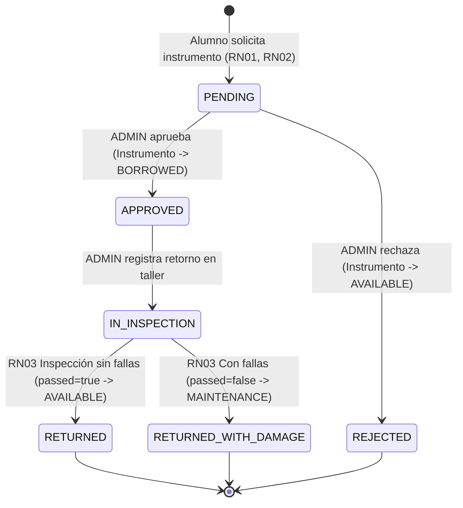

# D01 — Ficha Técnica del Proyecto y Requerimientos Funcionales y No Funcionales

## 1. Datos de Identificación
- **Institución:** Tecnológico Nacional de México — Instituto Tecnológico de Morelia
- **Asignatura:** Infraestructura de Servicios
- **Alumno:** José Antonio Navarro Meza (`22121327`)
- **Asesor:** Roque Trujillo Ramos
- **Nombre del Proyecto:** **SoniLab** — Sistema de Control de Préstamos y Trazabilidad de Instrumentos Musicales
- **Versión de Entrega:** `v1.0.0`
- **Fecha:** Octubre 2026

---

## 2. Definición del Problema, Dominio y Usuarios
### 2.1 Dominio y Problemática
En los talleres y laboratorios de música académica, el préstamo de instrumentos especializados (cuerda, viento, percusión y teclados electrónicos) suele gestionarse en bitácoras manuales o tablas aisladas que no registran el estado físico específico de cada componente al momento de su devolución. Esto ocasiona pérdida de trazabilidad cuando un equipo regresa con daños (cuerdas rotas, puente desalineado, zapatillas desgastadas o fallas en potenciómetros) y retrasa su envío a mantenimiento preventivo o correctivo.

### 2.2 Roles y Permisos de Usuario
| Rol | Descripción | Permisos Verificados en Servidor (JWT + Middleware RBAC) |
| :--- | :--- | :--- |
| **`ADMIN`** (Encargado de Taller) | Profesor o responsable del inventario musical. | CRUD completo de instrumentos y usuarios (incluyendo baja lógica), aprobación/rechazo de solicitudes, recepción en taller (`IN_INSPECTION`), cierre con dictamen técnico hacia MongoDB, rehabilitación de equipos en `MAINTENANCE` y consulta global de reportes. |
| **`STUDENT`** (Músico / Alumno) | Estudiante inscrito que solicita préstamos de instrumentos. | Consulta de catálogo paginado y filtrado, solicitud de préstamos sujeta a reglas RN01 y RN02, edición de perfil propio y consulta exclusiva de sus propios préstamos e inspecciones técnicas en MongoDB. |

---

## 3. Reglas de Negocio Propias y Máquina de Estados
1. **RN01 — Límite estricto de préstamos simultáneos por alumno:** Un estudiante únicamente puede mantener **un préstamo activo** a la vez (en estados `PENDING`, `APPROVED` o `IN_INSPECTION`). El servidor rechaza cualquier solicitud adicional con código `HTTP 400`.
2. **RN02 — Bloqueo operativo y físico del instrumento:** Los instrumentos con estado `MAINTENANCE`, `BORROWED` o dados de baja lógica (`active = false`) quedan bloqueados mediante bloqueo pesimista transaccional (`SELECT ... FOR UPDATE` en PostgreSQL) para impedir reservas concurrentes (`HTTP 409`).
3. **RN03 — Dictamen técnico polimórfico obligatorio al cierre:** Ningún préstamo en estado `IN_INSPECTION` puede cerrarse sin adjuntar un `checklist` técnico y un dictamen booleano (`passed`). Si `passed = true`, el préstamo pasa a `RETURNED` y el instrumento a `AVAILABLE`. Si `passed = false`, el préstamo pasa a `RETURNED_WITH_DAMAGE` y el instrumento pasa automáticamente a `MAINTENANCE`.

### Máquina de Estados del Préstamo

---

## 4. Requerimientos Funcionales y Criterios de Aceptación
| ID | Requerimiento Funcional | Entidad / Módulo | Criterio de Aceptación Verificable |
| :--- | :--- | :--- | :--- |
| **RF01** | Autenticación JWT y control de intentos | `users` (`/api/auth`) | Contraseñas con hash `bcrypt` (coste 10), bloqueo `HTTP 429` tras 5 intentos fallidos y verificación de rol en servidor. |
| **RF02** | CRUD de Usuarios con baja lógica | `users` (`/api/users`) | Alta, consulta paginada con búsqueda, edición de perfil y baja lógica (`active = false`) impidiendo acceso a cuentas inactivas (`HTTP 403`). |
| **RF03** | CRUD de Instrumentos y Catálogo | `instruments` (`/api/instruments`) | Semilla de 120 instrumentos en 4 categorías (`cuerda`, `viento`, `percusion`, `teclado`), filtros por categoría/estado/serie, paginación y baja lógica. |
| **RF04** | Flujo transaccional de Préstamos | `loans` (`/api/loans`) | Transacciones ACID con `SELECT ... FOR UPDATE`, validación de fechas, filtros por rango (`from_date`, `to_date`) y reporte de préstamos cerrados (`/api/loans/report`). |
| **RF05** | Bitácora técnica polimórfica y Outbox | `technical_inspections` / `outbox_events` | Escritura transaccional en `outbox_events` (PostgreSQL) y sincronización asíncrona idempotente hacia MongoDB validada con `$jsonSchema`. |

---

## 5. Requerimientos No Funcionales (SLO y Operación)
| ID | Atributo | Métrica / Umbral de Aceptación |
| :--- | :--- | :--- |
| **RNF01** | Rendimiento y Latencia (SLO) | Latencia `p95 < 1000 ms` y tasa de errores `< 1%` bajo carga sostenida de 20 usuarios concurrentes. |
| **RNF02** | Escalabilidad Horizontal | Backend 100% stateless con HPA (`autoscaling/v2`) escalando de 2 a 6 réplicas al superar 60% de CPU. |
| **RNF03** | Seguridad en Profundidad | Contenedores no-root (`UID 10001` y `UID 101`), `readOnlyRootFilesystem`, `seccompProfile: RuntimeDefault`, `NetworkPolicy` default-deny y TLS en Ingress. |
| **RNF04** | Continuidad y Recuperación | Respaldos diarios automatizados (`CronJob`), `RPO <= 24 horas` y `RTO <= 30 minutos` demostrado en restauración aislada. |
