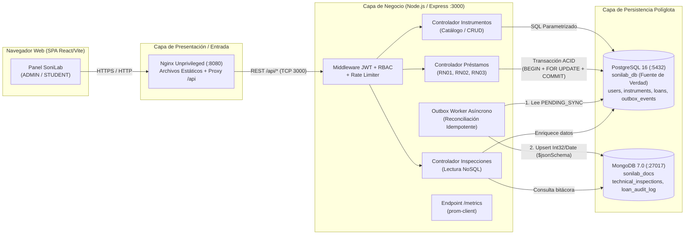
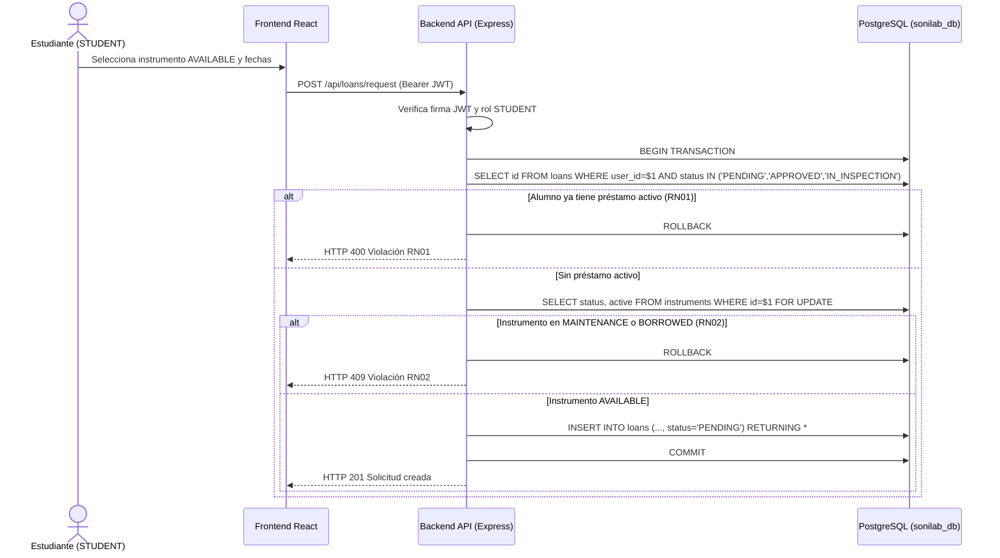
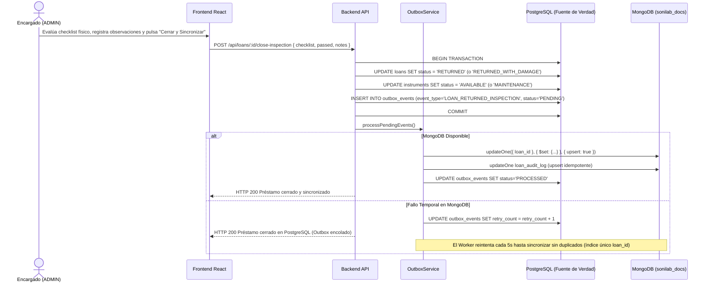
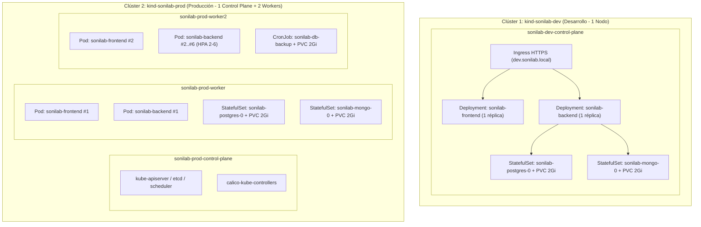

# D03 — Arquitecturas, Diagramas Obligatorios y Planeación de Capacidad

## 1. Arquitectura de la Aplicación Multicapa

---

## 2. Diagramas de Secuencia

### 2.1 Secuencia de un CRUD y Solicitud de Préstamo (Transacción ACID en PostgreSQL)

### 2.2 Secuencia de Cierre con Inspección Técnica (Ambos Motores + Patrón Outbox y Recuperación)

---

## 3. Arquitectura de Implementación por Ambiente (Desarrollo vs Producción)

---

## 4. Arquitectura de Comunicación y Red

| Parámetro de Red | Clúster Desarrollo (`kind-sonilab-dev`) | Clúster Producción (`kind-sonilab-prod`) |
| :--- | :--- | :--- |
| **Red Docker de Nodos** | `172.22.0.0/16` (`172.22.0.5`) | `172.22.0.0/16` (`172.22.0.2`, `.3`, `.4`) |
| **CIDR de Pods** | `10.244.0.0/16` | `192.168.0.0/16` (Calico CNI) |
| **CIDR de Services** | `10.96.0.0/12` | `10.96.0.0/12` |
| **DNS Interno** | `CoreDNS` (`10.96.0.10:53`) | `CoreDNS` (`10.96.0.10:53`) |
| **Dominio / Entrada** | `https://dev.sonilab.local` (`:8443`) | `https://prod.sonilab.local` (`:9443`) |

---

## 5. Inventario de Equipos y Presupuesto de Capacidad

### 5.1 Inventario del Equipo Anfitrión y Nodos del Clúster
| Nodo / Rol | Ambiente | SO / Imagen Base | Kernel / Runtime | IP Interna | Presupuesto Asignado |
| :--- | :--- | :--- | :--- | :--- | :--- |
| `sonilab-dev-control-plane` | Desarrollo | Debian GNU/Linux 13 (trixie) | Linux 6.18 WSL2 / `containerd://2.3.4` | `172.22.0.5` | 2 vCPU / 2 GiB RAM |
| `sonilab-prod-control-plane` | Producción | Debian GNU/Linux 13 (trixie) | Linux 6.18 WSL2 / `containerd://2.3.4` | `172.22.0.3` | 2 vCPU / 2 GiB RAM |
| `sonilab-prod-worker` | Producción | Debian GNU/Linux 13 (trixie) | Linux 6.18 WSL2 / `containerd://2.3.4` | `172.22.0.4` | 4 vCPU / 4 GiB RAM |
| `sonilab-prod-worker2` | Producción | Debian GNU/Linux 13 (trixie) | Linux 6.18 WSL2 / `containerd://2.3.4` | `172.22.0.2` | 4 vCPU / 4 GiB RAM |

### 5.2 Presupuesto de Recursos por Componente en Producción (`namespace: sonilab`)
| Componente | Réplicas (Mín–Máx) | CPU Request | CPU Limit | RAM Request | RAM Limit | Consumo Máximo Total (Escala Máxima) |
| :--- | :--- | :--- | :--- | :--- | :--- | :--- |
| `sonilab-frontend` | 2 | `50m` | `200m` | `64Mi` | `128Mi` | `400m` CPU / `256Mi` RAM |
| `sonilab-backend` (con HPA) | 2 a 6 | `100m` | `400m` | `128Mi` | `256Mi` | `2400m` CPU / `1536Mi` RAM |
| `sonilab-postgres` | 1 | `150m` | `500m` | `256Mi` | `512Mi` | `500m` CPU / `512Mi` RAM |
| `sonilab-mongo` | 1 | `150m` | `500m` | `256Mi` | `512Mi` | `500m` CPU / `512Mi` RAM |
| Exporters (`pg` + `mongo`) | 2 | `50m` c/u | `150m` c/u | `64Mi` c/u | `128Mi` c/u | `300m` CPU / `256Mi` RAM |
| **Total Aplicativo** | **8 a 12 Pods** | **`600m` (base)** | **`4.1 vCPU` (pico)** | **`896Mi` (base)** | **`3.0 GiB` (pico)** | Dentro de `ResourceQuota` (`6 CPU req / 12 CPU lim`) |
