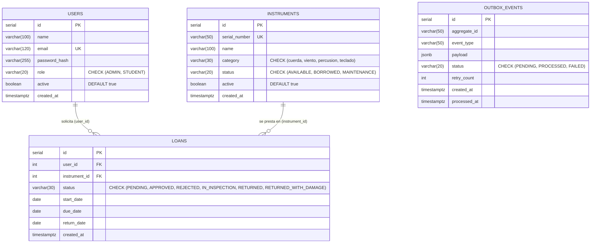

# D04 — Modelos de Datos, Diccionarios, Migraciones y Estrategia de Consistencia

## 1. Modelo Entidad-Relación (PostgreSQL — Fuente de Verdad Relacional)



---

## 2. Diccionario de Datos Relacional (`sonilab_db`)

### 2.1 Tabla `users`
| Columna | Tipo | Restricciones | Descripción |
| :--- | :--- | :--- | :--- |
| `id` | `SERIAL` | `PRIMARY KEY` | Identificador único autoincremental del usuario. |
| `name` | `VARCHAR(100)` | `NOT NULL` | Nombre completo del profesor o estudiante. |
| `email` | `VARCHAR(120)` | `UNIQUE NOT NULL` | Correo institucional usado para login. |
| `password_hash` | `VARCHAR(255)` | `NOT NULL` | Hash `bcrypt` (10 rondas de sal). |
| `role` | `VARCHAR(20)` | `NOT NULL CHECK (role IN ('ADMIN', 'STUDENT'))` | Rol de autorización verificable en servidor. |
| `active` | `BOOLEAN` | `DEFAULT TRUE` | Indicador de estado para baja lógica. |
| `created_at` | `TIMESTAMPTZ` | `DEFAULT CURRENT_TIMESTAMP` | Fecha de alta del registro. |

### 2.2 Tabla `instruments`
| Columna | Tipo | Restricciones | Descripción |
| :--- | :--- | :--- | :--- |
| `id` | `SERIAL` | `PRIMARY KEY` | Identificador único del instrumento. |
| `serial_number` | `VARCHAR(50)` | `UNIQUE NOT NULL` | Número de serie patrimonial (ej. `STR-0001`). |
| `name` | `VARCHAR(100)` | `NOT NULL` | Nombre y modelo del instrumento. |
| `category` | `VARCHAR(30)` | `CHECK (category IN ('cuerda','viento','percusion','teclado'))` | Categoría técnica que define el checklist de inspección. |
| `status` | `VARCHAR(20)` | `CHECK (status IN ('AVAILABLE','BORROWED','MAINTENANCE'))` | Estado operativo actual para la regla RN02. |
| `active` | `BOOLEAN` | `DEFAULT TRUE` | Baja lógica de instrumentos descontinuados. |

### 2.3 Tabla `loans` y Tabla `outbox_events`
- **`loans`:** Contiene las llaves foráneas `user_id REFERENCES users(id) ON DELETE RESTRICT` e `instrument_id REFERENCES instruments(id) ON DELETE RESTRICT`, e índices `idx_loans_user_id` e `idx_loans_status`.
- **`outbox_events`:** Almacena eventos transaccionales pendientes de sincronización hacia MongoDB con índice parcial `CREATE INDEX idx_outbox_pending ON outbox_events(status) WHERE status = 'PENDING'`.

### 2.4 Estrategia de Pool de Conexiones para Múltiples Réplicas del Backend
Cada réplica de `sonilab-backend` configura un `pg.Pool` con `max: 10` conexiones (`backend/src/index.js`). Con el límite máximo del HPA (`maxReplicas: 6`), el consumo tope es de $6 \times 10 = 60$ conexiones simultáneas, manteniéndose por debajo del límite por defecto de PostgreSQL (`max_connections = 100`) y reservando 40 conexiones para tareas administrativas, respaldos (`pg_dump`) y monitoreo (`postgres-exporter`).

---

## 3. Modelo Documental en MongoDB (`sonilab_docs`)

### 3.1 Colección `technical_inspections`
Almacena los dictámenes físicos de retorno con un esquema flexible para el campo `checklist` pero validado estrictamente en su estructura base mediante `$jsonSchema` (`database/mongo/01_init.js`):
- **Índice de Idempotencia:** `db.technical_inspections.createIndex({ loan_id: 1 }, { unique: true })`.
- **Ejemplo de documento almacenado:**
```json
{
  "loan_id": 15,
  "instrument_id": 2,
  "inspector_id": 1,
  "user_id": 2,
  "user_name": "Alumno Juan Perez",
  "user_email": "juan.perez@sonilab.edu",
  "instrument_name": "Bajo Eléctrico Fender Jazz Bass",
  "serial_number": "BASS-002",
  "category": "cuerda",
  "passed": false,
  "status": "RETURNED_WITH_DAMAGE",
  "checklist": {
    "cuerdas": false,
    "afinacion": true,
    "mastil": true,
    "pastillas": true
  },
  "notes": "Cuerda Mi rota al momento de la devolución.",
  "inspected_at": "2026-10-31T22:02:13.099Z"
}
```

### 3.2 Colección `loan_audit_log`
Registra la bitácora histórica de eventos de cierre y auditoría con índices en `{ loan_id: 1 }` y `{ created_at: -1 }`.

---

## 4. Estrategia de Consistencia e Idempotencia (Patrón Transactional Outbox)
1. **Fuente de verdad:** PostgreSQL es la fuente de verdad autoritativa.
2. **Escritura atómica:** Al cerrar una inspección (`POST /api/loans/:id/close-inspection`), el backend abre una única transacción en PostgreSQL donde actualiza `loans.status`, `instruments.status` e inserta el evento `LOAN_RETURNED_INSPECTION` en `outbox_events`.
3. **Sincronización sin duplicados:** `OutboxService` (`backend/src/services/outbox.service.js`) selecciona lotes con `FOR UPDATE SKIP LOCKED` (seguro para múltiples réplicas del backend corriendo en paralelo) y ejecuta `updateOne({ loan_id }, { $set: ... }, { upsert: true })` en MongoDB. Aunque un evento se procese más de una vez tras una reconexión, el índice único `{ loan_id: 1 }` y la operación `upsert` garantizan **cero registros duplicados**.
